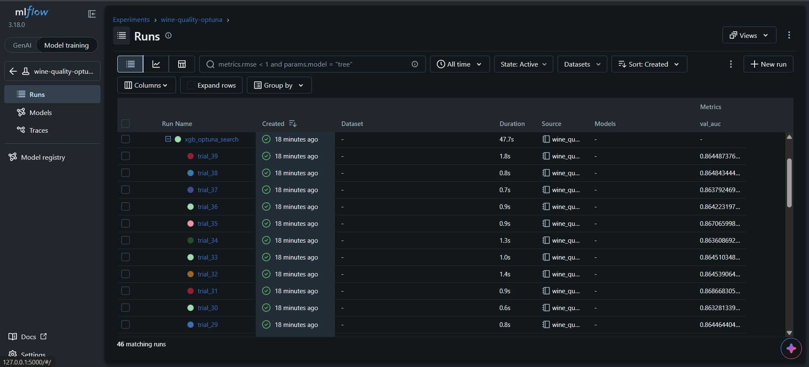
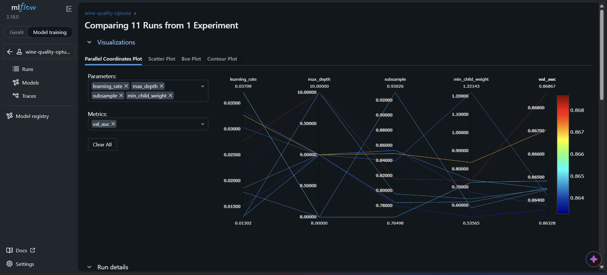
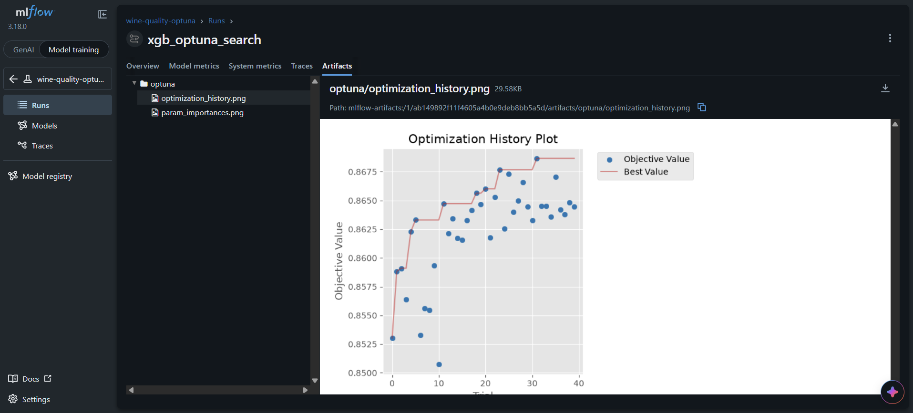
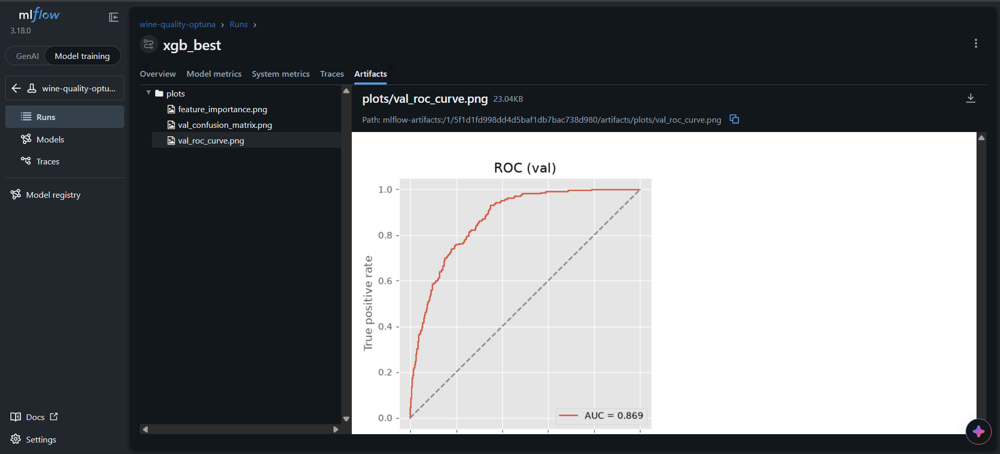
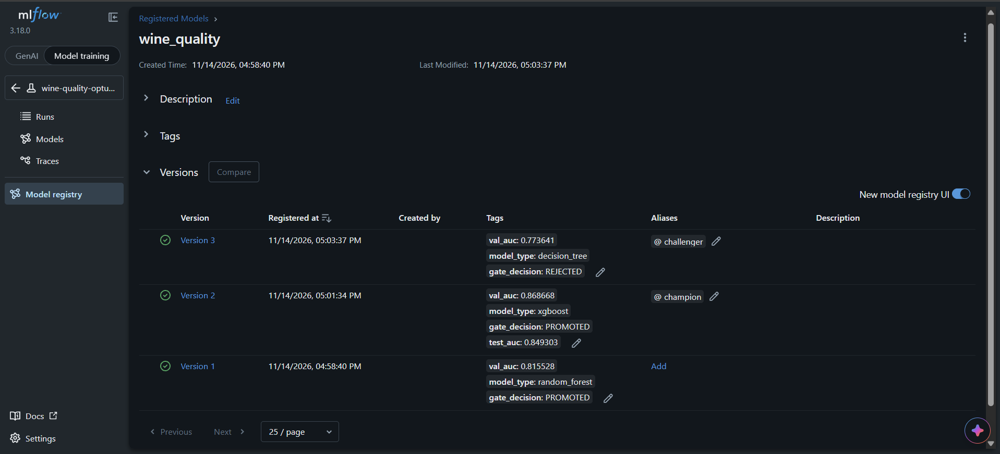
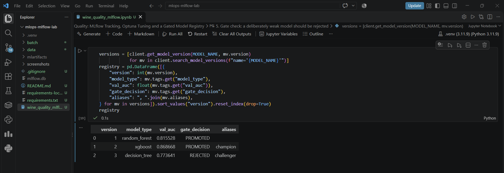
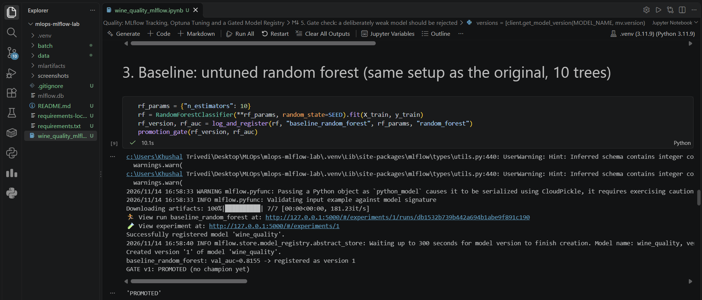
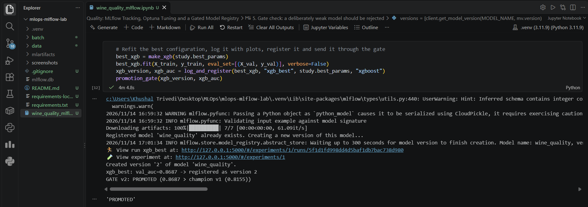
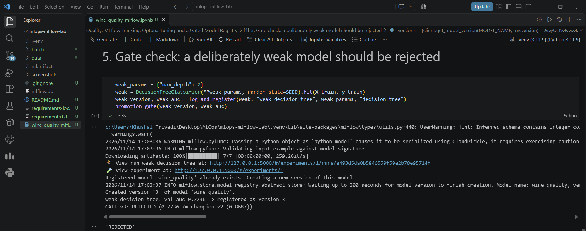
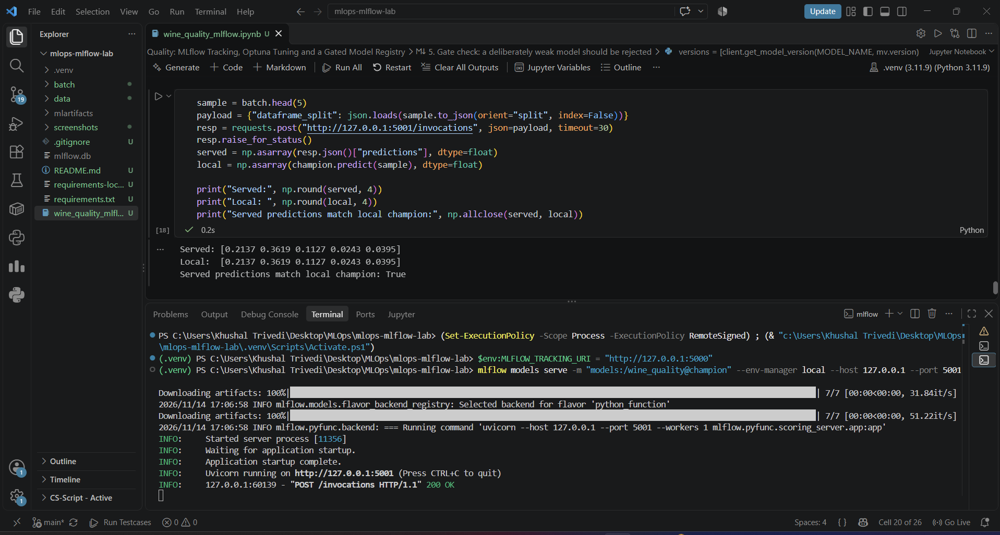

# Wine Quality: MLflow Tracking, Optuna Tuning and a Gated Model Registry

Modified version of [Lab2 from raminmohammadi/MLOps](https://github.com/raminmohammadi/MLOps/tree/main/Labs/Experiment_Tracking_Labs/Mlflow_Labs/Lab2) (Experiment Tracking Labs / MLflow Labs).

The original lab trains a random forest baseline on the UCI wine quality data, tunes XGBoost with Hyperopt on Spark, promotes models with registry stages, and runs batch inference through a Spark UDF on a Delta table. Several of those steps only run on Databricks or use APIs MLflow has since deprecated. This version runs end to end on a laptop and adds a promotion gate.

## Changes from the original

| Area | Original | This repo | Why |
|---|---|---|---|
| Duplicates | Raw concat of red + white | 1,177 exact duplicate rows (18%) dropped before splitting | Copies of the same wine in train and test inflate AUC |
| Split | Random 60/20/20 | Stratified 60/20/20 | Only about 20% of wines are high quality |
| Tuning | Hyperopt + SparkTrials (needs Spark and Java) | Optuna TPE, 40 trials, nested runs under one parent | Runs locally; Optuna history and parameter-importance plots logged |
| Search space | `max_depth` 4 to 100 | `max_depth` 3 to 10, plus subsample and colsample | 100 is far too deep for ~5k rows |
| Model logging | Autolog plus manual `log_model` in every trial (2 models per trial) | Trials log params and metrics only; best config refit and logged once | No duplicate artifacts |
| Model selection | `search_runs` ranks the baseline's test AUC against the trials' validation AUC | Every candidate ranked on validation AUC; test set used once on the final champion | Fair comparison, no test leakage into selection |
| Artifacts | AUC metric only | ROC curve, confusion matrix, feature importance per model; datasets logged with `mlflow.log_input` | Visible evidence for each run in the UI |
| Registry | Stages (`Production`, `Archived`) | Aliases `champion` / `challenger` | Stages are deprecated |
| Promotion | Always promotes the new model | Gate: challenger becomes champion only if its validation AUC is higher; a deliberately weak decision tree shows a rejection | Same idea as a CI quality gate |
| Model wrapper | Random forest only, private `_mlflow_conda_env` | One `ProbaModel` wrapper for any sklearn-style model, public `pip_requirements` | Private APIs can break between versions |
| Batch inference | Spark UDF on an undefined Delta table | pandas scoring of an incoming CSV with `models:/wine_quality@champion`, predictions logged as an artifact | Runs without Databricks |
| Serving | Commented-out command | `mlflow models serve --env-manager local` plus a check that served predictions match local ones | Works on Windows without pyenv |
| Tracking backend | Default local files | `mlflow server` with SQLite backend | One server for UI, registry and serving |
| Plotting | `sns.distplot` | `sns.histplot` | `distplot` is deprecated |

## Repo layout

```
data/                        red and white wine CSVs + winequality.names
wine_quality_mlflow.ipynb    the full lab
batch/                       created by the notebook: incoming_wines.csv, predictions.csv
screenshots/                 MLflow UI and serving screenshots
requirements.txt             minimum versions
requirements-lock.txt        exact versions used for the results below
```

## How to run

Tested with Python 3.11.9 on Windows (mlflow 3.18.0, xgboost 3.2.0, optuna 5.0.0, scikit-learn 1.9.1).

```
python -m venv .venv
.venv\Scripts\Activate.ps1        # Mac/Linux: source .venv/bin/activate
pip install -r requirements-lock.txt
```

Terminal 1, tracking server and UI (open http://127.0.0.1:5000):
```
mlflow server --backend-store-uri sqlite:///mlflow.db --host 127.0.0.1 --port 5000
```

Run `wine_quality_mlflow.ipynb` top to bottom up to section 8.

Terminal 2, serve the champion:
```
$env:MLFLOW_TRACKING_URI = "http://127.0.0.1:5000"     # Mac/Linux: export MLFLOW_TRACKING_URI=http://127.0.0.1:5000
mlflow models serve -m "models:/wine_quality@champion" --env-manager local --host 127.0.0.1 --port 5001
```

Then run the last notebook cell to query the endpoint.

## Results

| Version | Model | Validation AUC | Gate decision | Alias |
|---|---|---|---|---|
| v1 | Random forest, 10 trees (baseline) | 0.8155 | PROMOTED (no champion yet), later replaced by v2 | - |
| v2 | XGBoost, best of 40 Optuna trials | 0.8687 | PROMOTED (0.8687 > 0.8155) | champion |
| v3 | Decision tree, depth 2 (gate check) | 0.7736 | REJECTED (0.7736 <= 0.8687) | challenger |

Champion (v2, XGBoost) on the untouched test set: AUC 0.8493, F1 0.3986, accuracy 0.8383.

AUC holds close to validation (0.8687 -> 0.8493). F1 is low because only 19% of wines are positive and predictions use a 0.5 threshold; always predicting "not high quality" would already score about 0.81 accuracy. Tuning the threshold on validation (or using scale_pos_weight) would raise F1 and is the next change I would make. The best trial also hit max_depth=10, the upper bound of the search space, so widening that range is a reasonable next experiment.

The served endpoint returns the same probabilities as the champion loaded in the notebook (checked with `np.allclose` on 5 rows).

The original notebook reports 0.854 test AUC for the baseline on data with duplicates. Numbers here are on deduplicated data, so they are not directly comparable.

## Screenshots

| What it shows | Screenshot |
|---|---|
| Experiment runs, 40 Optuna trials nested under the parent run |  |
| Trials compared in parallel coordinates (params vs val_auc) |  |
| Optuna optimization history logged to the parent run |  |
| Best XGBoost run: logged plots and validation ROC curve |  |
| Registry: three versions with champion / challenger aliases |  |
| Registry table from the notebook |  |
| Gate v1: baseline promoted (no champion yet) |  |
| Gate v2: XGBoost promoted over the baseline |  |
| Gate v3: weak decision tree rejected |  |
| Serving the champion and the endpoint response |  |

## Credit

Original lab and dataset setup by [Ramin Mohammadi](https://github.com/raminmohammadi/MLOps). Data: P. Cortez et al., Wine Quality, UCI Machine Learning Repository (see `data/winequality.names`).